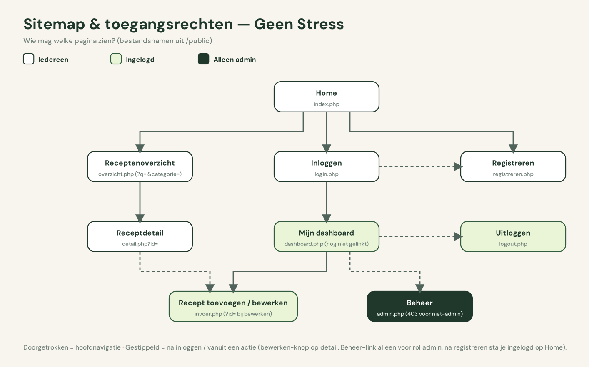
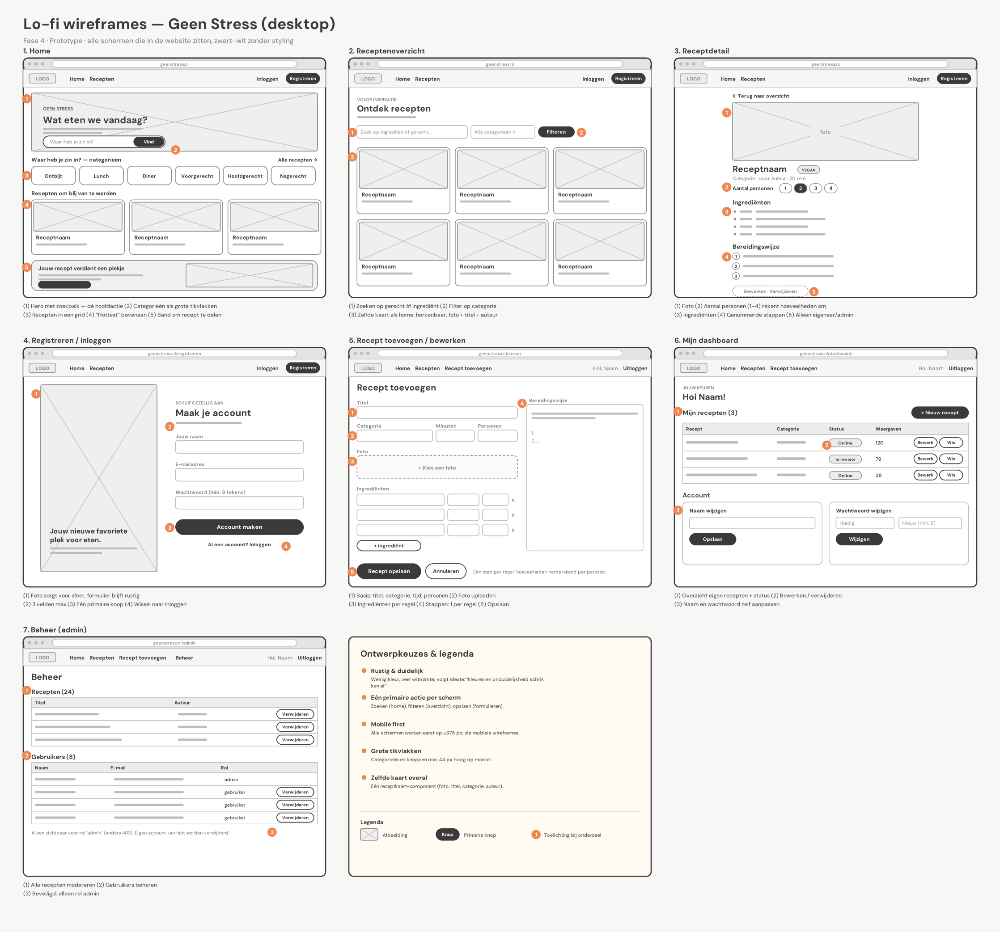
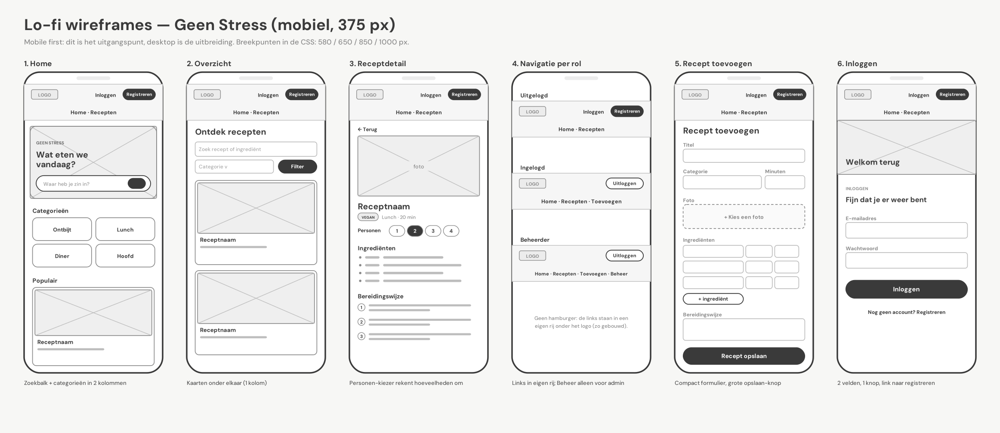
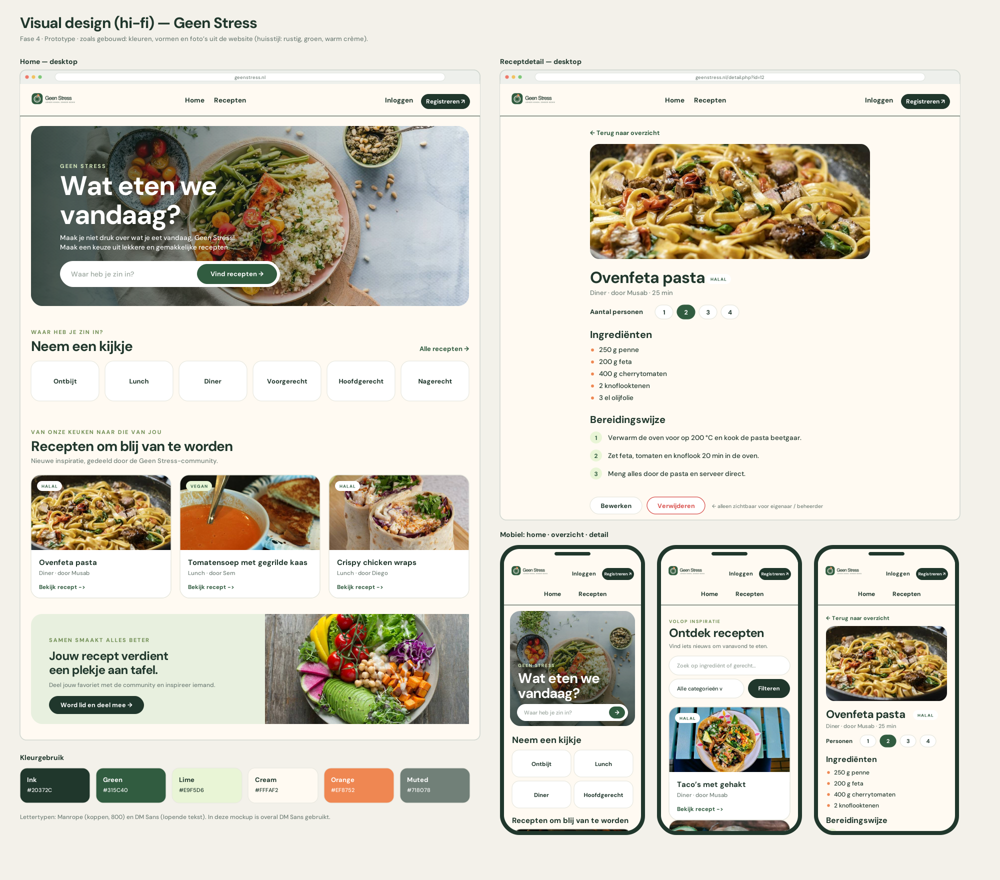
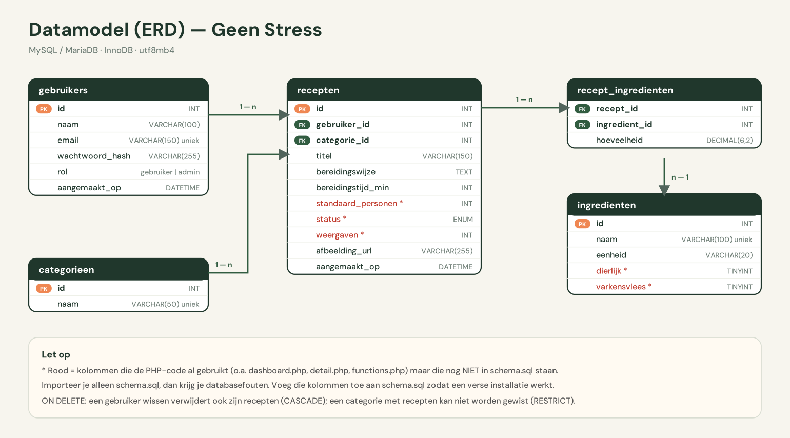

# Fase 4: Prototype (Ontwerp & Techniek)

In deze fase vertalen we het eindconcept uit [Ideate](03-ideate.md) naar schermen en een werkende website. We gingen van **lo-fi** (zwart-wit wireframes, alleen indeling) naar **hi-fi** (kleur, foto's, huisstijl) naar een **werkend prototype** in PHP.

## 1. Sitemap & user flow

De sitemap laat zien welke pagina's er zijn en wie ze mag zien. De [user flow](03-ideate.md) uit Ideate toont de route van de bezoeker.



| Pagina | Bestand | Wie? |
|---|---|---|
| Home | `index.php` | Iedereen |
| Receptenoverzicht (zoeken & filteren) | `overzicht.php` | Iedereen |
| Receptdetail | `detail.php?id=` | Iedereen |
| Inloggen / registreren | `login.php`, `registreren.php` | Iedereen |
| Recept toevoegen / bewerken | `invoer.php` | Ingelogd |
| Mijn dashboard | `dashboard.php` | Ingelogd *(in ontwikkeling, zie [Test](05-test.md))* |
| Beheer | `admin.php` | Alleen admin (anders 403) |

## 2. Wireframes (Lo-Fi)

We begonnen met zwart-wit wireframes zonder kleur of foto's, zodat we alleen over **indeling en navigatie** praten. Elk scherm heeft genummerde toelichtingen.

### 2.1 Desktop



### 2.2 Mobiel (Mobile First)

Onze doelgroep gebruikt vooral de telefoon, dus het mobiele ontwerp is het uitgangspunt.



### 2.3 Schermoverzicht

| # | Scherm | Doel | Belangrijkste onderdelen | Eis (MoSCoW) |
|---|---|---|---|---|
| 1 | Home | Snel inspiratie | Zoekbalk in hero, categorieën, receptkaarten, "deel je recept"-band | Must: zoeken, bekijken |
| 2 | Overzicht | Gericht zoeken | Zoekveld (gerecht/ingrediënt), categoriefilter, kaartengrid | Must: zoeken · Should: filteren |
| 3 | Receptdetail | Koken | Foto, tijd, personen-kiezer, ingrediënten, genummerde stappen | Must: ingrediënten + bereiding · Should: tijd tonen |
| 4 | Registreren / inloggen | Account | 2–3 velden, één primaire knop | Must: inloggen en registreren |
| 5 | Recept toevoegen | Delen | Titel, categorie, tijd, personen, foto, ingrediëntenregels, stappen | Should: recept toevoegen en delen |
| 6 | Dashboard | Eigen recepten beheren | Tabel met status en acties, naam/wachtwoord wijzigen | Should: eigen recept aanpassen |
| 7 | Beheer | Moderatie | Tabellen recepten en gebruikers | Beheerfunctie uit Eindconcept |

## 3. Visual Design (Hi-Fi)

Het hi-fi ontwerp gebruikt de echte huisstijl en foto's van de website.



### 3.1 Huisstijl

| Onderdeel | Keuze | Waarom |
|---|---|---|
| Sfeer | Rustig, warm, uitnodigend | Uit Ideate: "veel kleuren en onduidelijkheid schrikken mensen af" |
| Achtergrond | Crème `#FFFAF2` | Warmer en rustiger dan wit |
| Tekst & knoppen | Donkergroen `#20372C` (ink) | Hoog contrast (12,3 : 1 op crème) |
| Accent | Groen `#315C40`, lime `#E9F5D6` | Fris, associeert met verse ingrediënten |
| Detail-accent | Oranje `#EF8752` | Alleen voor kleine accenten zoals opsommingstekens |
| Koppen | Manrope (800) | Sterk en goed leesbaar |
| Lopende tekst | DM Sans (400–700) | Rustig en modern |
| Vormen | Afgeronde hoeken (17–24 px), pillen voor knoppen | Vriendelijk en tikbaar |
| Beeld | Grote gerechtfoto's per recept | Je wilt zien wat je gaat maken |

### 3.2 Herbruikbare onderdelen

- **Receptkaart**: foto (205 px hoog), titel, categorie + auteur, "Bekijk recept". Overal hetzelfde.
- **Dieetbadge**: *Vegan* of *Halal* op de foto, automatisch afgeleid uit de ingrediënten (geen varkensvlees → halal; geen dierlijke ingrediënten → vegan).
- **Personen-kiezer**: knoppen 1–4 die de hoeveelheden direct herberekenen.
- **Knoppen**: donker (primair), wit met rand (secundair), rood omlijnd (verwijderen).

### 3.3 Responsive gedrag

De CSS heeft breekpunten op **1000, 850, 650 en 580 px**. Op mobiel komen de navigatielinks in een eigen rij onder het logo (geen hamburgermenu) en staan de kaarten in één kolom of twee kolommen (≤ 850 px).

## 4. Technische architectuur

### 4.1 Stack

* **Frontend:** HTML5, CSS3 (één stylesheet, CSS-variabelen), vanilla JavaScript (alleen de personen-kiezer). Geen framework. Lettertypen via Google Fonts.
* **Backend:** PHP 8+ met PDO, server-side gerenderde pagina's, sessies voor inloggen.
* **Data:** MySQL/MariaDB (InnoDB, utf8mb4). Afbeeldingen van gebruikers komen in `public/uploads/`.
* **Hosting:** Plesk; document root is de map `public/`.

### 4.2 Mappenstructuur

```text
Stop-De-Ontkoking/
├── docs/                  Documentatie (Docsify)
├── TEAM.md                Team Charter
└── Geen-Stress-web/
    ├── config/            database.php, config.local.example.php
    ├── includes/          auth.php, functions.php, header.php, footer.php
    ├── public/            ← document root
    │   ├── index.php, overzicht.php, detail.php, invoer.php
    │   ├── login.php, registreren.php, logout.php
    │   ├── dashboard.php, admin.php
    │   ├── css/style.css
    │   ├── images/        gerechtfoto's en logo
    │   └── uploads/       foto's die gebruikers uploaden
    └── schema.sql         Databasestructuur + startdata
```

### 4.3 Hoe een pagina werkt

```text
Browser → public/pagina.php
            ├─ config/database.php   (PDO-verbinding)
            ├─ includes/auth.php     (sessie, rollen)
            ├─ includes/functions.php (queries en hulpfuncties)
            ├─ includes/header.php   (navigatie)
            ├─ …pagina-inhoud (HTML + PHP)…
            └─ includes/footer.php
```

### 4.4 Datamodel



* Eén gebruiker heeft veel recepten; één categorie heeft veel recepten.
* Een recept heeft veel ingrediënten via de koppeltabel `recept_ingredienten`, met de hoeveelheid per recept.
* De dieetbadge wordt berekend uit de vlaggen `dierlijk` en `varkensvlees` op `ingredienten`.
* Rollen: `gebruiker` en `admin`.

> ⚠️ **Let op:** de rood gemarkeerde kolommen gebruikt de code al, maar ze staan nog niet in `schema.sql`. Zie [05. Test → bevindingen](05-test.md).

### 4.5 Installatie (Plesk)

1. Upload de inhoud van `Geen-Stress-web/` naar de server. Houd `config/`, `includes/`, `public/` en `schema.sql` bij elkaar.
2. Zet de **document root** op `public/`.
3. Maak in Plesk een MySQL/MariaDB-database en -gebruiker aan en importeer `schema.sql` via phpMyAdmin.
4. Kopieer `config/config.local.example.php` naar `config/config.local.php` en vul de databasegegevens in.
5. Gebruik PHP 8+ met de extensies PDO en PDO MySQL.
6. Zorg dat `public/uploads/` schrijfbaar is.

### 4.6 Beveiliging

| Onderwerp | Hoe nu opgelost |
|---|---|
| Wachtwoorden | `password_hash()` / `password_verify()`, minimaal 8 tekens |
| SQL-injectie | Prepared statements (PDO) |
| XSS | Alle uitvoer via `htmlspecialchars` (`h()`) |
| Toegang | `vereist_login()` en `vereist_admin()` (403) |
| Uploads | Type-controle met `mime_content_type`, willekeurige bestandsnaam |
| CSRF | Nu alleen op `dashboard.php`; rest staat in het [iteratieplan](05-test.md) |

## 5. Ontwerpkeuzes

| Keuze | Onderbouwing |
|---|---|
| Zoekbalk groot in de hero | Pain "geen inspiratie": snel iets vinden is de hoofdactie |
| Zoeken op ingrediënt | Pain "niet alle ingrediënten in huis" |
| Personen-kiezer | Pain "moeilijke recepten": niet zelf hoeven rekenen |
| Genummerde stappen | Gain "duidelijke stappen die makkelijk te volgen zijn" |
| Foto's centraal | Jayden zoekt inspiratie via TikTok/Instagram: beeld eerst |
| Weinig kleuren en veel witruimte | Rustige UI uit het eindconcept |
| Geen mobiele app, wel responsive site | Won't have uit [Define](02-define.md) |
| Eenvoudig stack (PHP + MySQL) | Past bij onze vaardigheden en bij Plesk-hosting |
